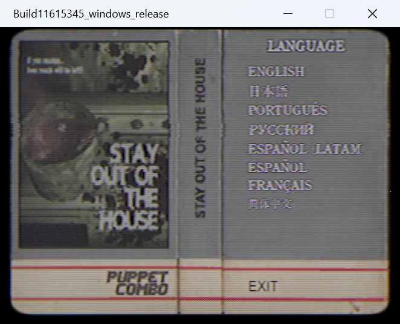
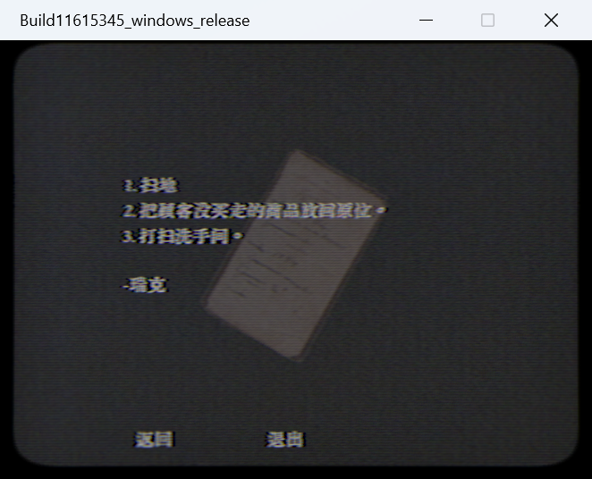
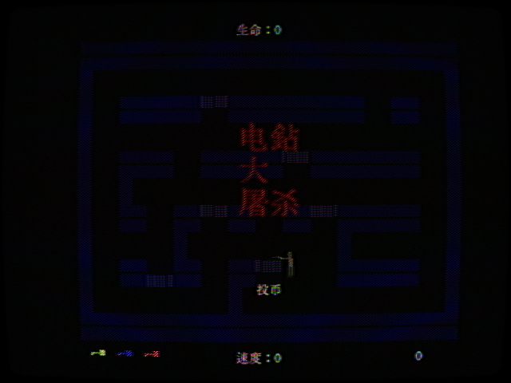
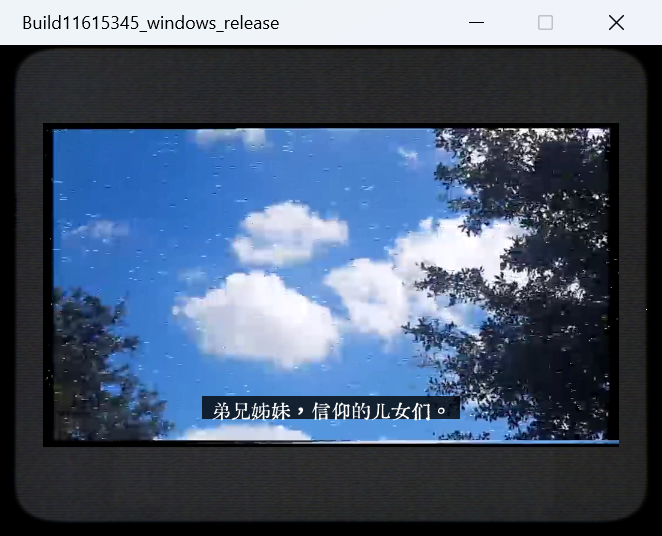

# Stay Out of the House 简体中文补丁

适用于 **Windows Steam Build 11615345**，App ID 896520，游戏内版本 1.1.7。

[下载 v1.0.1 图形安装包](https://github.com/newbility/Stay_Out_of_the_House_CN/releases/download/v1.0.1/StayOutOfTheHouseCN-1.0.1.zip) · [SHA-256 校验](https://github.com/newbility/Stay_Out_of_the_House_CN/releases/download/v1.0.1/StayOutOfTheHouseCN-1.0.1.zip.sha256) · [版本说明](https://github.com/newbility/Stay_Out_of_the_House_CN/releases/tag/v1.0.1)

## 安装与恢复

1. 退出游戏，完整解压 ZIP，启动 `StayOutOfTheHouseCN-Installer.exe`。
2. 粘贴 Steam 游戏目录，或用「浏览…」选择该目录。检查状态后点「安装汉化」。
3. 启动游戏，在语言菜单选择「简体中文」。
4. 恢复时先退出游戏，再用安装器选择同一目录，点「恢复原版」。原版备份保存在游戏目录的 `.StayOutOfTheHouseCN/original`。

使用过本地版 1.0.0 时，先用该版本的安装器恢复原版，再安装 1.0.1。

## 汉化内容

校对并回填 1,625 条语言表记录，覆盖菜单、对白、交互、文档、操作提示及成就等。包括老板便条中文图页、两个证件转录页，以及讲道影片与两版讲道录音的同步中文字幕。影片字幕叠加在玩家本机原版播放器的画面上。

安装包从最终 ZIP 解压验收，验证手动输入、图形浏览、安装、从内部测试版升级和原版恢复。游戏实测取自隔离副本，覆盖代表性界面、文档、街机、字幕和有限剧情抽检。世界标牌和多数手写图页保留原美术，文档阅读器提供对应的中文文字页。

## 实机画面

| 简体中文语言选项 | 老板便条 |
| --- | --- |
|  |  |
| **街机** | **讲道影片字幕** |
|  |  |

## 版权与免责声明

1. 本补丁仅供学习与交流使用，不得用于任何商业用途，请在已购买正版游戏的前提下使用。
2. 游戏文本及资源的版权归开发者、发行商或相应权利人所有。中文译文采用 [CC BY-NC-SA 4.0](licenses/CC-BY-NC-SA-4.0.txt)。匯文明朝體 GBK 1.001 遵循随附的[字体授权声明](licenses/Huiwen-MinchoGBK-LICENSE.txt)。如有侵权，请联系移除。
3. 本汉化包为非官方汉化程序。对于使用汉化包造成的任何损失，汉化作者不负任何责任。
4. 使用前请仔细阅读并理解本协议。使用本补丁即表示同意遵守上述条款和条件。如不同意，请勿使用。
